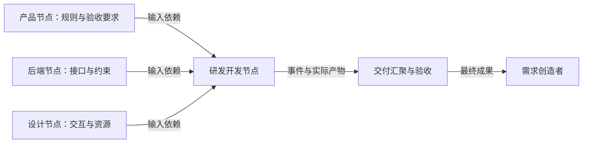
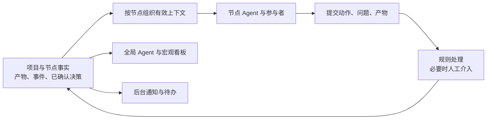
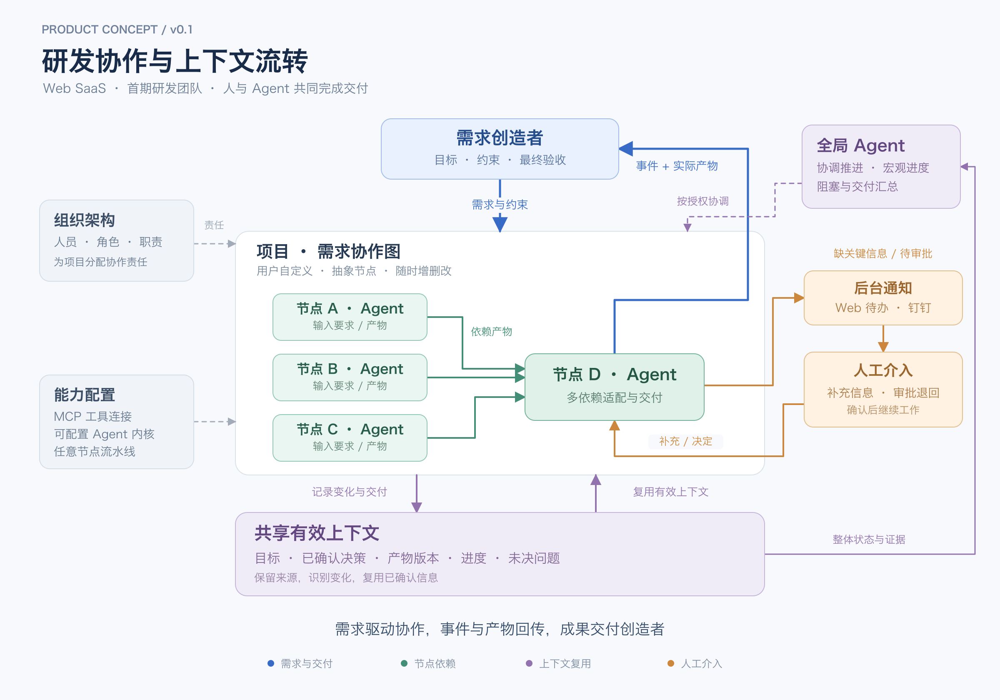

# 研发协作与上下文流转平台 PRD

| 项目 | 内容 |
| --- | --- |
| 版本 | v0.1 · 概念评审版 |
| 日期 | 2026-10-10 |
| 产品形态 | 轻量 SaaS，第一阶段以 Web 为工作入口 |
| 首期用户 | 研发团队及参与需求交付的协作人员 |
| 产品名称 | 待定；agent-workflow 仅为文档目录名 |
| 文档目的 | 固化产品共识，给出可评审的业务规则、首期范围和闭环验收方案 |
| 当前阶段 | 产品概念已形成，尚未开发、试点或验证收益 |

**阅读约定：**「已确认」表示用户在讨论中明确表达的需求；「建议」表示为形成闭环提出的评审基线；「待决」表示仍需产品决策。建议方案不等于已获确认的承诺。本文不预设技术栈、交付工期或商业定价。

## 1. 产品定义与首要价值

产品以图结构组织需求分解与协作依赖，让各节点 Agent 基于持续维护的有效项目上下文，理解本节点需要什么、依赖方交付了什么、还缺少什么，并由人和 Agent 共同完成适配、执行、修订与验收。

**需求与约束沿协作关系传递，事件与产物沿交付关系汇聚，需求创造者最终收获满足需求的成果。**

首要价值是降低跨人员、跨角色、跨 Agent 重新建立上下文的成本。成员无需反复整理已经明确的项目背景、沟通过的结论和最新进度；此前形成的有效信息能够直接用于后续工作。

减少沟通、明确责任、推动交付、沉淀上下文共同服务于这个目标。首期成功标准是人机协同完成真实交付，并证明 Agent 在材料整理、适配、问题发现或信息交接中产生了实际价值。

### 1.1 当前问题

- 产品、设计、后端、客户端等角色分别持有材料与判断，接收方需要自行查找、翻译和拼接。
- 同一段需求背景和已确认结论，需要重复解释给其他人及其 Agent，过程中容易遗漏条件和例外。
- 「上游已经提交」与「下游已经可以使用」之间存在缺口，缺少对交付适用性的明确记录。
- 需求、接口、设计发生变化后，相关节点和 Agent 可能继续使用过期信息。
- 进度汇报与实际工作分离，管理者和参与者需要反复询问状态、责任人和阻塞原因。
- 完成状态未必关联可访问、可验证的成果，需求创造者难以判断是否真正交付。

### 1.2 首期目标与边界

| 目标 | 可观察的结果 |
| --- | --- |
| 保持上下文连续 | 后续节点能获取任务背景、有效材料、已确认决策和待解决问题 |
| 提高交接质量 | Agent 能指出具体输入要求与产物之间的满足项、缺项和冲突 |
| 形成合理的人机闭环 | 缺少关键信息时通知人工，补充后能继续；正式退回经过人工批准 |
| 让整体进展可理解 | 全局 Agent、节点详情和看板基于一致的事实解释进度 |
| 完成交付 | 事件与实际产物一同回传，最终成果被需求创造者取得并验收 |

后续探索包括 Codex CLI 等本地执行工具。它们不进入本期核心范围。完整插件市场、通用 CI/CD 托管平台、计费体系和对所有企业工具的深度集成，也不作为本期建议验收条件。

## 2. 已确认的产品共识

| 编号 | 已确认内容 |
| --- | --- |
| C01 | 产品为轻量 SaaS；第一阶段面向研发团队，以 Web 为工作入口 |
| C02 | 同时存在组织架构与项目—需求两个维度，借助组织能力完成需求交付 |
| C03 | 节点是抽象对象，具体含义由用户定义；初始化时为空，不预置固定业务流程 |
| C04 | 节点采用图结构，可同时依赖多个节点，并支持自行增加、修改和删除 |
| C05 | 节点配置自己的输入要求，Agent 将其与依赖节点产物匹配并分析缺失与冲突 |
| C06 | Agent 整理问题，经人工审批后定向退回上游产物，并附带批准后的分析结果 |
| C07 | 不确定情况的处理标准可配置；默认缺少关键信息时通知人工补充 |
| C08 | 人工介入是正常工作环节，以整体流程跑通且 Agent 有实际价值为目标 |
| C09 | 全局 Agent 承担整体协调与控制，理解项目进展；节点变化形成的信息供看板和相关节点复用，具体控制权限待配置与细化 |
| C10 | 避免成员重复组织语言，以及产品、研发等不同 Agent 重建上下文的成本 |
| C11 | 数据流借鉴 UDF；回传的不只是事件，还有实际产物，需求创造者最终取得成果 |
| C12 | 后台具备通知机制，可衔接企业聊天工具，钉钉为明确提出的接入目标 |
| C13 | 支持 MCP 接入及 Agent 内核配置，首期接入深度尚待细化 |
| C14 | 流水线思想可应用于任意节点，不限于研发或代码构建节点 |
| C15 | Android、产品、后端和设计是说明概念的案例，不是系统固定的节点类型 |
| C16 | Codex CLI 等工具接入属于后续扩展，不影响当前主产品定义 |

## 3. 使用者与职责

以下是**建议的职责模型**，用于说明权限和责任，不要求每种职责对应独立岗位，也不将人员等同于节点。

| 角色 | 主要职责 | 关键操作 |
| --- | --- | --- |
| 需求创造者 | 提出目标、交付要求与验收条件，最终取得需求产物 | 创建需求、确认关键决策、查看与验收最终成果 |
| 项目协调者 | 组织协作关系，处理跨节点责任及阻塞 | 配置节点关系、协调待办、查看整体进展 |
| 节点责任人 | 对本节点输入要求及交付负责 | 确认输入、处理 Agent 问题、批准反馈、提交产物 |
| 节点协作者 | 参与材料补充和工作执行 | 处理分配给自己的事项、提供产物与说明 |
| 验收人 | 判断交付是否满足已约定条件 | 接受产物、退回修订、确认最终交付 |
| 组织管理员 | 维护组织成员、职责和可用连接 | 管理成员、权限、工具及模型连接 |
| 节点 Agent | 理解任务、适配材料、识别问题、准备交接与产出 | 分析、提问、调用授权工具、提交产物和建议 |
| 全局 Agent | 理解整体进度、关系和交付情况，并承担全局协调 | 汇总进展、解释阻塞、分析影响，按配置提出或发起流程动作；控制范围见 D11 |

建议每个进行中的节点至少有一个可定位的人工处理责任人。是否必须唯一、是否允许团队认领，以及最终验收人能否被委派，见待决事项 D03。

组织关系用于表达人员、职责和权限；项目关系用于表达本次目标、交付和依赖。组织汇报层级不自动决定流程执行顺序。

## 4. 核心对象与关系

以下为概念模型，不是数据库表设计。

| 对象 | 含义与最小信息 |
| --- | --- |
| 组织 | 企业或团队的协作边界，包含成员、职责和权限 |
| 项目 | 一组相关需求与协作工作的容器；建议一个项目可含多个需求 |
| 需求 | 目标、创造者、交付对象、范围、验收条件及最终成果 |
| 节点 | 可配置的抽象工作单元；其含义、输入、输出、参与者和 Agent 职责由用户定义 |
| 关系 | 表达需求分解、成果交付或物料依赖；关系的具体分类为建议方案 |
| 输入要求 | 当前节点需要的参数、变量、规则、资料或能力，以及满足条件 |
| 产物 | 可被引用和验收的实际交付，包括文档、接口说明、设计、文件、功能成果或其他材料 |
| 事件 | 已发生的事实，如提交、补充、批准、退回、变更、失败和验收 |
| 动作／请求 | 人或 Agent 提出的操作，尚需规则处理或人工决定；不等同于已发生事件 |
| 有效上下文 | 与当前节点相关且仍有效的目标、产物、决策、进展、约束及未决问题 |
| 人工介入项 | 一个待人处理的问题，带有已知信息、缺口、依据、影响和处理对象 |
| 验收记录 | 谁基于什么要求，对哪个版本的产物作出了什么结论 |

### 4.1 图结构的表达

- 已确认：一个节点可依赖多个节点，节点含义与关系由用户配置。
- 建议：分别表达「我需要谁的产物」和「我的成果交给谁」，避免用一条没有语义的线承担所有含义。
- 建议：允许同一份产物被多个消费者引用，消费者分别判断是否满足自己的要求。
- 待决：是否保留分组层级、是否允许任意循环依赖、跨需求依赖范围，见 D01、D02。
- 图上的反馈和修订可以通过新事件、新产物版本表达；业务返工不必等同于新增反向执行依赖。

以下仅是多依赖示例，不是初始化模板或固定节点类型：

### 4.2 事件与产物并行回传

事件回答「发生了什么」，产物回答「实际交付了什么」。两者应关联同一需求、节点和相应版本。

节点可以接收需求、依赖其他节点或继续拆解工作，再将自己的事件与成果交给对应接收方。「向上」指成果向委派方及需求创造者汇聚，不代表行政汇报关系。

提交完成事件时，应能定位相关产物或明确说明本节点为何无独立文件产物。最终需求完结必须关联可访问成果及验收结果，不能只由全部节点的结束标记推导。

## 5. 单向数据流与共享上下文

### 5.1 数据流原则

借鉴 UDF 的状态与动作分离思路，但将交付产物纳入流程事实：

建议由明确的流程规则确认状态变更；Agent 提交分析、产物和操作请求。需要人工审批的请求获批后，才形成正式退回或其他相应事件。

「统一事实」是业务上一致的记录，不要求物理上使用一个巨大状态对象，也不要求全部原始信息进入每个 Agent 的上下文。

### 5.2 有效上下文的内容

| 内容 | 必须回答的问题 |
| --- | --- |
| 目标与范围 | 为什么做、当前节点需要完成什么、有哪些边界 |
| 已确认输入 | 哪些材料和约定可直接使用，来源是什么 |
| 历史决策 | 已经讨论并确定了什么，为什么会有当前约束 |
| 当前进展 | 相关节点正在做什么，哪里等待或阻塞 |
| 未决事项 | 缺少什么，谁需要回答，对继续工作的影响是什么 |
| 变化与失效 | 哪些原有信息已改变，需要重新检查什么 |
| 验收条件 | 怎样判断本节点及最终需求已经满足要求 |

建议明确标注原始材料、人工确认结论、AI 分析、待确认事项与失效结论。保留来源和版本，支持从总结定位原始依据，避免在连续摘要中丢失关键条件。

### 5.3 同一事实的三种用途

- 宏观看板：目标、当前进展、责任人、阻塞、关键决策与交付情况。
- 节点上下文：本节点实际需要的完整约束、有效材料、差异及待解决问题。
- 通知与待办：发生了什么、与接收者的关系、需要其处理什么、处理入口。

三者基于同一批事实分别组织。全局 Agent 的推测不自动成为其他节点的既定要求；可见范围仍按组织与项目权限决定。

## 6. 第一阶段功能范围

以下优先级为**建议的首期范围**。P0 指验证核心闭环所需，P1 指闭环稳定后增强。已确认的能力方向与尚未确认的接入深度分别注明。

| 编号 | 模块 | P0 建议范围 | 对应共识 |
| --- | --- | --- | --- |
| FR01 | 组织与项目 | 组织成员、基本职责与权限；项目、需求、创造者与验收要求 | C01、C02 |
| FR02 | 自定义节点图 | 空白创建；节点及关系增删改；查看多依赖及变更影响 | C03、C04、C15 |
| FR03 | 输入与产物 | 描述输入要求；提交和引用产物；来源、版本及验收关联 | C05、C11 |
| FR04 | 节点 Agent | 组织上下文；多依赖匹配；缺失、冲突和问题归属分析 | C05、C10 |
| FR05 | 人工介入 | 可配置规则；缺关键通知；补充、重新分析和继续 | C07、C08 |
| FR06 | 交接验收与退回 | 人工审阅、编辑并批准反馈；定向修订、复查、接受 | C06 |
| FR07 | 全局理解与协调 | 宏观看板、阻塞解释、变更与交付汇总；按确认后的权限配置协调流程 | C09、C10 |
| FR08 | 后台通知 | Web 待办；钉钉最小接入；发送结果可见和失败处理 | C12 |
| FR09 | MCP 与 Agent 配置 | 可配置连接和职责；验证一条实际需要的工具读取链路；内核配置深度见 D07 | C13 |
| FR10 | 节点流水线 | 任意节点配置检查、Agent 分析、人工确认、提交等基本步骤 | C14 |
| FR11 | 最终成果 | 关联原始需求，汇聚实际产物，验收及完结 | C11 |
| FR12 | 记录与恢复 | 追溯输入、分析、审批和产物；等待恢复；防止旧结果误推进 | C08、C10、C11 |

P1 建议包括模板沉淀、批量配置、丰富的工具连接、聊天内审批、组织同步和更复杂的流水线控制。具体分期以试点结果评审。

### 6.1 FR01：组织、项目与需求

- 维护成员及其项目职责，允许同一成员参与多个项目并承担不同角色。
- 创建需求时记录目标、创造者、预期产物和验收要求；尚未明确的信息可标为待澄清。
- 建议项目包含多个需求，每个需求拥有独立的交付与完结记录。
- 需求创建不自动生成固定的产品、设计、后端、测试等节点。
- 首期建议采用邀请制团队试点并具备组织数据隔离；开放注册、计费与组织同步见 D09。

### 6.2 FR02：空白节点图及动态调整

- 空白状态提示用户创建节点、定义含义及关联输入，不以预设研发流程替代配置。
- 节点可配置名称、说明、职责、参与者、输入要求、预期输出、Agent 与处理规则。
- 支持增删节点、修改节点定义、增删依赖及调整交付对象。
- 已确认支持运行过程中的调整。建议在受理变更前展示受影响节点、输入和产物，按 D02 明确生效范围。
- 建议删除使节点退出当前图，保留已有产物、审批和历史引用；悬空的必要依赖必须被提示和处理，不能继续显示为已满足。
- 建议检测无法启动的循环等待并解释原因。是否限制依赖图成环，需在 D01 决定。

### 6.3 FR03：输入要求与实际产物

- 用户可用自然语言描述需要的参数、变量、规则和资料；Agent 可辅助整理要求清单，由责任人确认关键条件。
- 建议首期支持文本、文件及外部材料引用；外链存在不代表内容已经成功读取，具体入口见 D05。
- 对输入要求记录必要程度、预期形式、满足条件及依据，避免将接收方临时偏好默认为上游既定责任。
- 建议产物记录来源节点、提交者、版本、说明及可访问入口；更新形成新版本并保留历史。
- 同一产物可面向不同接收方形成独立验收记录。提交、可读取、适配通过、最终验收通过是不同事实。

### 6.4 FR04：节点 Agent 适配分析

分析输入包括本节点目标、输入要求、相关有效上下文及依赖产物。输出至少包含以下业务信息：

| 输出 | 要求 |
| --- | --- |
| 满足项 | 对应哪条要求、引用哪个产物及内容 |
| 缺失项 | 缺少什么、为什么影响当前工作 |
| 冲突项 | 哪些来源互相矛盾，具体矛盾在哪里 |
| 可适配项 | 基于明确依据进行命名、格式或表达转换，并保留对应关系 |
| 未决问题 | 当前无法确定的关键事实，以及建议处理人 |
| 影响与建议 | 哪些工作受影响、建议补充或修订什么、复查条件是什么 |

Agent 对每个依赖分别检查，再检查多个产物之间的一致性。对没有证据的业务含义不得包装成已确认事实。例如金额单位未定义时，应请求澄清，不能仅根据字段名决定转换规则。

建议记录分析所依据的输入与产物版本。旧版本分析完成时，如果输入已变化，结果应标明适用版本并重新评估，不能直接推进新版本流程。

### 6.5 FR05：可配置的不确定性处理与人工补充

- 已确认默认策略：缺少关键信息时走通知机制请求人工介入。
- 建议以「必要输入缺失、来源冲突、关键业务规则未定义、工具无法读取、操作超出授权」等情形定义处理规则；不只依赖模型自报的置信度。
- 处理选项可包括请求补充、等待人工决定、允许带明确假设继续非阻塞工作；首期具体配置项见 D04。
- 人工介入项包含已知信息、缺失内容、来源依据、影响、处理对象和处理入口。
- 人工可回答、补材料、修改问题归属或说明无需处理；形成明确记录后重新分析。
- 无法定位处理对象时，建议交给项目协调者；无人响应的升级策略见 D08。
- 在等待期间保留任务与上下文，不要求 Agent 会话持续在线。

### 6.6 FR06：人工批准的定向退回

- Agent 生成反馈草稿，用户可逐项接受、编辑、忽略或要求重新分析。
- 正式退回内容以人工批准版本为准，发送给相关产物责任方，并附要求、证据、影响与复查条件。
- 区分既定要求未满足、需求尚未明确和新增要求。后两者应进入澄清或变更确认，避免直接归责上游。
- 建议退回针对「当前接收方对指定产物版本的验收」，不自动撤销其他接收方的验收结论。
- 上游提交修订后，关联原问题逐项复查，并检查修订是否影响其他已满足项。
- 对退回有异议时，建议提交给需求负责人或指定裁决者，保留各方依据；具体权限见 D03。

### 6.7 FR07：全局 Agent 与宏观看板

- 保留全局协调与控制职责：按配置提出或发起流程动作，具体动作、自动执行范围及审批要求见 D11；不能仅以只读总结能力替代这一方向。
- 汇总项目目标、需求进展、各分支责任人、阻塞、待人工事项和产物交付情况。
- 回答「现在进行到哪里」「为什么没有交付」「本次变化影响谁」，并能定位对应记录。
- 并行流程展示多个当前处理节点和责任人，不强制压缩为唯一的「当前处理人」。
- 不以节点数量简单推算完成百分比；首期建议优先呈现事实性进度，算法化进度另行定义。
- 宏观分析与节点更新共同使用已记录事实，未确认判断单独标注。
- 全局 Agent 可准备成果汇总和交接材料；它本身的总结不替代实际产物与验收。

### 6.8 FR08：后台通知与企业聊天工具

- 关键业务事项先形成可追踪的 Web 待办，后台按收件人与渠道配置发送通知；不依赖浏览器持续在线。
- 建议首期钉钉实现通知与直达对应 Web 事项，具体应用形态及聊天内审批见 D06。
- 优先通知：需要补充、需要审批、产物被退回、相关输入发生重要变化、关键执行失败及最终成果待验收。
- 通知带需求、节点、事项摘要与操作入口；实际可见内容遵循接收者权限。
- 建议合并短时间内同一问题的重复提醒，记录发送成功、失败及重试情况。
- 通知失败不丢失待办，也不等于处理失败；消息送达不等于用户已批准或已处理。

### 6.9 FR09：MCP 与 Agent 内核配置

- 保留产品能力：节点使用可配置的 Agent 内核，Agent 可通过 MCP 使用已配置工具。
- 建议配置分为连接层、节点职责层和权限层：内核／模型连接、角色要求、工具集合、上下文范围、不确定性策略。
- 首期至少通过一种可用配置验证分析闭环，并通过一个真实材料来源验证 MCP 接入；具体内核和服务待定。
- 「支持 MCP」不等于能够读取所有外部页面。工具是否可用、内容是否获取成功、来源版本和调用失败应明确可见。
- 外部写操作应遵循项目授权与审批规则；首期工具写入范围见 D07。
- 外部 Agent 运行时的完整插件化、内核热替换及本地 CLI 执行均不在本文默认承诺中。

### 6.10 FR10：任意节点的基本流水线

- 节点可挂载自动化处理步骤，产物类型不限于代码。
- 建议首期步骤包括检查输入、Agent 分析、调用已授权工具、人工确认、提交产物与发出交付事件。
- 例如「新设计提交 → 检查状态与资源 → 对照需求分析 → 人工确认 → 形成交付版本」。该示例不绑定节点类型。
- 步骤需要显示执行结果、产物和阻塞原因，支持从等待点继续。
- 任意脚本、复杂并行调度、任意循环及通用构建环境属于扩展深度，见 D10。

### 6.11 FR11–FR12：最终交付、记录与恢复

- 汇聚需求所需的实际成果，展示与原始目标及验收条件的对应关系。
- 建议由需求创造者或其明确指定的验收人确认最终成果，验收权见 D03。
- 子节点结束但最终目标未满足时，需求仍保持待验收或需修订；不自动宣布完结。
- 完结后可以找到最终产物、验收结果、关键决策及相关版本；后续需求可引用仍有效的材料。
- 建议等待、分析任务及审批记录持久保存，服务重启后能识别真实状态，继续处理或明确提示恢复事项。
- 重复回调或重复点击不应造成重复正式退回、重复验收或重复外部操作。外部操作结果不明时先核实，不直接重复执行。

## 7. 状态与推进规则（建议评审基线）

正式名称可以调整，核心是区分执行过程、输入就绪和产物是否被接受。

| 维度 | 建议状态 | 说明 |
| --- | --- | --- |
| 节点本轮执行 | 待开始、处理中、等待人工、受阻、暂停、执行异常、本轮结束、已取消 | 「本轮结束」只说明此次工作停止，不自动代表交付验收通过 |
| 输入适配 | 未满足、待确认、满足、需复验 | 应能定位具体依赖、要求、产物和原因 |
| 接收方验收 | 待验收、已接受、需修订、需复验 | 针对指定产物版本及接收方，不使用一个全局标记覆盖所有消费者 |
| 需求交付 | 草稿、进行中、待最终验收、需修订、已完结、已取消 | 完结关联最终产物与明确的验收记录 |
| 人工介入项 | 待处理、已补充／已决定、复查中、已解决、已取消 | 回复后仍需检查是否真正补齐问题 |

关键推进原则：

1. 哪些输入必须满足才能开始或继续，由节点规则定义；建议默认关键缺口阻塞受影响工作。
2. Agent 运行错误与业务验收失败分别记录，不能因为工具超时直接判定产物不合格。
3. 人工回答与审批均关联原事项，处理后更新上下文并触发相应复查。
4. 输入或图关系变化后重新判断适用性；旧分析不直接覆盖新状态。建议沿已记录的产物来源识别直接及间接影响，即使中间产物尚未发布新版本，受影响结论也应标记需复验，直至复查通过或明确确认不受影响。
5. 一次提交可生成多项后续检查，但相同输入版本不应因自己的分析事件无限触发分析。
6. 未经批准的退回建议，不对外显示为正式退回。

## 8. 主要用户路径

### 8.1 从空白到需求交付

创建项目与需求 → 明确目标及验收条件 → 自定义节点和关系 → 配置职责、输入输出与 Agent → 提交依赖产物 → Agent 整理有效上下文并分析 → 人工处理必要事项 → 节点执行与交付 → 汇聚最终成果 → 最终验收 → 完结。

### 8.2 缺关键信息

Agent 发现缺口 → 创建带依据的人工介入项 → 后台发送通知 → 相关人员补充 → 信息进入有效上下文 → Agent 复查 → 满足后继续；仍不满足时保留具体缺口。

### 8.3 适配不通过与返工

Agent 形成问题草稿 → 下游责任人编辑并批准 → 对指定产物正式退回 → 上游收到反馈并修订 → 提交新版本 → 下游重新检查 → 接受或继续说明未满足项。

### 8.4 上游或图结构发生变化

提交变更 → 沿依赖与产物来源识别直接和间接影响 → 按确认后的生效规则更新 → 相关上下文和衍生产物标记需复验 → 通知受影响人 → 重新分析／验收，或有依据地确认不受影响 → 继续交付。

### 8.5 通知或 Agent 服务异常

记录异常 → 保留待办、输入与产物 → Web 展示可处理状态 → 允许重试或人工接管 → 恢复后回到明确的处理点。不会因一次推送或模型调用失败丢失整个业务流程。

## 9. Web 信息架构（建议）

| 页面／区域 | 主要内容 | 用户应能完成的动作 |
| --- | --- | --- |
| 我的工作 | 待补充、待审批、被退回、待验收及相关变更 | 直接处理事项，查看必要背景 |
| 组织与项目 | 成员、职责、项目、需求列表 | 管理参与关系，进入具体协作 |
| 需求工作区 | 目标、验收条件、节点图、产物和活动记录 | 建立和调整流程，查看交付情况 |
| 节点详情 | 输入要求、依赖产物、适配结果、有效上下文、问题与产出 | 提交、补充、审批、退回、复查 |
| 宏观看板 | 当前分支、责任人、阻塞、关键变化与最终成果 | 理解真实进度，定位依据和处理入口 |
| 连接与策略 | Agent、MCP、通知渠道、人工介入规则 | 配置可用能力和执行边界 |

图编辑是配置入口之一。日常处理应允许从待办直接进入问题和产物，避免每次都要求用户理解整张图。

## 10. 首期验收用例（建议）

以下为产品验收标准草案，尚未执行。业务示例用于验证通用能力，不固化为节点类型。

| 编号 | 场景与操作 | 通过标准 |
| --- | --- | --- |
| AT01 | 新建需求，自行增加、命名并关联节点 | 初始无固定业务节点；可建立自定义图和多依赖关系 |
| AT02 | 研发同时依赖产品、后端、设计，提交三方材料 | Agent 能分别检查并联合适配，结论引用对应要求及材料 |
| AT03 | 关键业务规则缺失 | 发起带已知信息和缺口的人工待办；补充后复查并继续，相关节点可复用结论 |
| AT04 | AI 提出三项退回建议，人工仅批准两项 | 正式反馈只包含批准内容；接收方、产物版本和复查条件明确 |
| AT05 | 后端产物需修订，其他依赖已满足 | 反馈定位后端问题；其他有效信息继续保留；修订后对新版本复查 |
| AT06 | 已使用的产物发生变更，旧分析稍后才结束 | 展示影响与输入版本；旧结果可查看，但经针对新版本的有效性复查后才能用于新版验收或推进 |
| AT07 | 执行中增加必要依赖，或移除关键产物提供节点 | 重新判断就绪程度，显示缺口与影响；不存在失去来源仍标为满足的状态 |
| AT08 | 关闭 Web 后发生待审批事项，分别验证钉钉发送成功与失败 | 成功时目标负责人实际收到消息，链接定位正确事项，登录后按权限处理并回写同一待办；失败时 Web 待办保留，发送失败可见且可恢复 |
| AT09 | 新节点加入，读取已有项目背景及确认结论 | 无需原参与者重新解释已记录信息；可追溯来源并区分未决内容 |
| AT10 | 子节点全部执行结束，但最终成果不满足验收要求 | 需求不自动完结；修订验收后，创造者能取得最终产物和验收记录 |
| AT11 | 修改不确定性策略后遇到同类信息缺口 | 按生效策略处理；默认缺关键通知人工；已有执行采用哪版策略可追溯 |
| AT12 | 使用已配置 MCP 获取材料，随后模拟读取失败 | 成功内容可关联来源；失败明确显示且走补充／恢复流程，不伪造读取结果 |
| AT13 | 非代码节点配置检查、人工确认和产物提交步骤 | 能显示步骤状态并从等待点继续，节点名称或类别不限制使用 |
| AT14 | 等待人工期间服务重启，随后补充信息；重复提交同一审批 | 等待事项可恢复，重复操作不产生重复正式业务动作 |
| AT15 | 不同权限成员查看节点汇总和通知 | 只显示其可访问材料与结果，摘要及通知不绕过原有访问范围 |
| AT16 | 输入 A → 衍生产物 B → 下游成果 C，A 更新而 B 暂未更新 | 系统识别对 B、C 的潜在间接影响；受影响结论先标为需复验，经检查通过或确认不受影响后恢复有效 |
| AT17 | 按 D11 确认的策略，让全局 Agent 发起一项协调动作及一项需审批动作 | 获授权动作按规则执行并有记录；需审批动作进入人工待办，未批准前不发生正式业务变更 |

最低综合验收路径：AT01 → AT02 → AT03 → AT04 → AT05 → AT09 → AT10，并补充 AT06／AT07 的变更场景、AT08 的通知异常、AT12／AT13 的扩展基础能力。

## 11. 价值验证与质量要求

### 11.1 价值指标（先测基线，再定目标）

| 指标 | 观察方式 | 需要同时检查的代价 |
| --- | --- | --- |
| 重复解释次数 | 记录交接时再次输入已知背景或结论的次数 | 是否转变为大量节点配置与材料维护 |
| 澄清往返次数 | 记录从收到材料到可开展工作之间的问答轮次 | 是否漏问关键问题，造成后续返工 |
| 上下文准备时间 | 比较人工准备与使用节点上下文的耗时 | 加上人工检查 Agent 结果的时间 |
| 有效问题发现 | 人工确认分析中的缺项、冲突和归属是否正确 | 误报，以及把不满足错误判断为满足 |
| 信息复用情况 | 检查后续节点能否使用已有决策和产物 | 是否引用过期版本或丢失例外条件 |
| 闭环完成情况 | 检查真实需求是否经历补充／返工后完成验收 | 是否需要管理员在系统外修补流程状态 |

首轮建议选择一条真实跨角色需求，与近期相近需求或人工处理基线比较。暂不填写未经验证的节省百分比、成功率或响应时限。

### 11.2 质量要求

- 可追溯：关键判断能够关联输入、版本、人工决定和最终产物。
- 可恢复：人工等待、工具异常和服务恢复后不会丢失已确认结果。
- 状态一致：看板、节点和待办使用同一业务事实，明确区分事实与分析。
- 可控通知：避免重复催办，发送状态可见，事项与消息分别管理。
- 权限明确：具备组织与项目边界；连接凭证与普通产物分开管理，不放入消息或模型上下文。
- 可理解：用户能够知道「正在等什么、由谁处理、完成条件是什么」。
- 成本可观察：建议记录分析耗时和调用消耗，避免每次小变化都触发全项目重复分析；具体预算策略后定。

## 12. 待决事项与建议默认值

| 编号 | 需要确认的事项 | 建议评审基线 | 最晚决策阶段 |
| --- | --- | --- | --- |
| D01 | 图关系类别、循环及分组层级 | 区分交付与依赖；显式处理循环等待；返工使用修订轮次 | 原型与状态设计前 |
| D02 | 运行中修改、删除的生效与历史保留 | 展示影响，保留历史；删除退出当前图，必要依赖重新确认 | 原型与状态设计前 |
| D03 | 负责人、验收人、代办和争议裁决 | 每节点有明确处理人；最终验收归创造者或指定人 | 权限与验收设计前 |
| D04 | 不确定性规则的配置粒度、部分继续和自动接受范围 | 默认关键缺口请求人工；正式退回始终先审批 | Agent 交互设计前 |
| D05 | 首期材料类型、首个真实来源及项目—需求关系 | 文本／文件／引用起步；选择一个真实外部来源；一项目多需求 | 试点与接入设计前 |
| D06 | 钉钉接入形态、身份关联、聊天内审批 | Web 待办为记录，钉钉通知并直达 Web | 通知设计前 |
| D07 | Agent「内核可配置」的具体含义、MCP 范围和外部写操作 | 先验证一种内核配置及一个材料读取工具，再扩展 | 技术方案与首期估算前 |
| D08 | 通知重试、无人响应、任务失败后的升级策略 | 失败可见、可重试、可人工接管；时限由试点确定 | 异常流程设计前 |
| D09 | SaaS 入驻、组织同步、部署及商业范围 | 邀请制团队试点、基本隔离与权限，计费后置 | 试点准备前 |
| D10 | 通用节点流水线的首期深度 | 固定基本步骤可组合，先不承诺任意脚本与完整 CI/CD 环境 | 技术方案与首期估算前 |
| D11 | 全局 Agent 可控制的动作，以及建议、自动执行和人工审批的界线 | 基于统一事实发起有授权的协调动作；状态变化遵循规则，正式退回保持人工审批 | Agent 交互与权限设计前 |

这些待决项不妨碍评审产品概念，但在相应开发工作开始前需要形成明确决定。

## 13. 推进 TODO 与完成条件

| 阶段 | TODO | 退出条件 |
| --- | --- | --- |
| 已交付 | 概念 PRD、产品概念图和可编辑关系源文件 | 内容覆盖已确认需求，建议与待决项明确 |
| 产品评审 | 确认 D01–D04、D11，选定真实需求与参与角色 | 节点、关系、人工介入、控制权限和验收语义可执行 |
| 原型验证 | 画出空白建图、节点适配、补充、退回、复验和最终验收路径 | 使用者能走完一轮，无需额外口头解释关键操作 |
| 接入与技术方案 | 决定 D05–D10，验证模型／工具／通知连接 | 明确可用来源、权限、失败处理与首期能力边界 |
| 最小闭环实现 | 实现 FR01–FR12 的确定范围 | 实际产物可流转，人工介入后可继续，最终成果可验收 |
| 系统验收 | 执行 AT01–AT17，对不在首期范围的用例记录明确原因 | 每项有通过、失败或未执行记录；阻塞缺陷有处置 |
| 真实试点 | 跑完一条需求，并经历一次补充／退回及一次变更 | 创造者取得成果，能比较沟通和上下文准备成本 |
| 迭代决策 | 根据试点决定模板、连接和其他执行工具扩展 | 用实际收益和缺口确定下一期范围 |

## 14. 产品概念图与文档范围

概念图展示组织与项目、需求创造者、抽象协作节点、节点 Agent、共享上下文、全局 Agent、人工介入和事件／产物回传之间的关系，不代表前端页面布局。

- [可编辑概念图 SVG](./product-concept.svg)
- [可编辑概念关系图 Mermaid](./product-concept.mmd)
- [概念图重建脚本](./render-concept.py)
- [概念图生成说明与提示词记录](./product-concept-prompt.md)

本文及图中的节点示例只用于解释关系。产物类型、具体工作流、内核与工具选型由后续配置和评审决定。本次交付为产品文档与概念图，没有实现服务、连接钉钉或执行实际业务验收。
